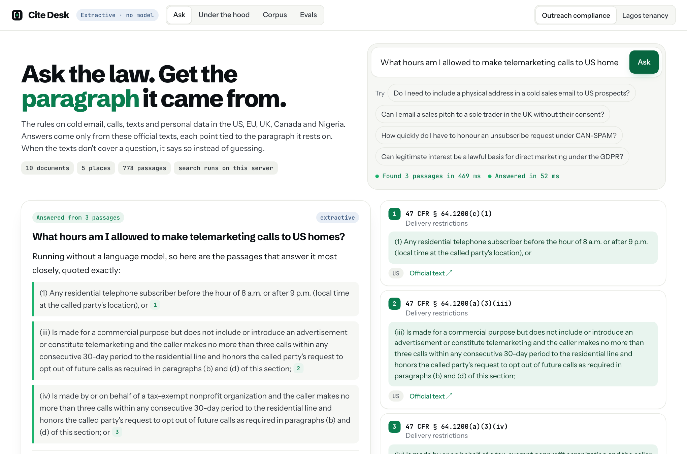
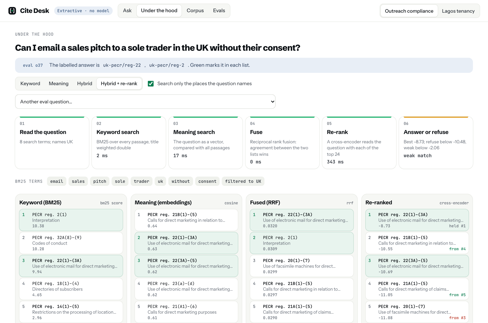

# Cite Desk

[](https://github.com/AbiodunOlaoluwa/cite-desk/actions/workflows/test.yml)

Ask a question about the law and get the paragraph it came from, or a plain "these documents don't cover that". Retrieval-augmented generation over real, official legal texts, with hybrid search, re-ranking, paragraph-level citations, a refusal gate, and evals that show what each stage adds.

Two collections ship with it:

- **Outreach compliance**: the rules on cold email, calls, texts and personal data. CAN-SPAM (the Act, the FTC rule and the FTC's guide), the TCPA and the FCC's telemarketing rules (US), the GDPR and the ePrivacy Directive (EU), PECR (UK), CASL (Canada) and the NDPC's GAID 2025 (Nigeria). 10 documents, 503 provisions, about 135,000 words.
- **Lagos tenancy**: the Tenancy Law of Lagos State 2011, all 49 sections.



## Try it

```bash
uv sync --group dev
uv run python -m cite_desk serve        # http://127.0.0.1:8050
```

The first start downloads two small models (about 130 MB, once) and builds the search indexes (about 45 seconds). Everything after that runs on your machine with no API key.

```bash
uv run python -m cite_desk ask "Can I email a sales pitch to a sole trader in the UK without their consent?"
uv run python -m cite_desk ask "How much notice must a landlord give a monthly tenant?" --collection lagos-tenancy --trace
```

To have Claude write the answers instead of quoting passages: `CITE_DESK_MODE=anthropic ANTHROPIC_API_KEY=... uv run python -m cite_desk serve`.

## What happens to a question

Take "Can I email a sales pitch to a sole trader in the UK without their consent?"

1. **Read the question.** Stop words are dropped for keyword search (`email`, `sales`, `pitch`, `sole`, `trader`, `uk`, `without`, `consent`), and the places it names are detected. It names the UK, so only UK documents are searched. That filter alone lifts the share of questions whose first result is right from 55% to 64%.
2. **Keyword search (BM25).** SQLite's FTS5 scores every passage on the words it shares with the question, with the passage's title weighted double. Here it puts PECR's definitions first (regulation 2, where "individual" includes an unincorporated body of individuals, which is what a sole trader is) and regulation 22 third. It takes 2 ms and is exact, and it is blind to wording it hasn't seen.
3. **Meaning search (embeddings).** The question becomes a 384-number vector (`bge-small-en-v1.5`, running locally on ONNX) and is compared with every passage's vector. That's 778 vectors in a plain matrix, so a full comparison takes a few milliseconds and no vector database is needed. It ranks regulation 22 second and third, behind 21B, a rule on pension cold calls that talks about direct marketing in similar language.
4. **Fuse.** Reciprocal rank fusion merges the two top-40 lists: each passage scores 1/(60 + its rank) in each list it appears in. Regulation 22 is near the top of both, so it comes first, with the definitions second. Agreement wins; one method's odd pick doesn't take over.
5. **Re-rank.** A cross-encoder (`ms-marco-MiniLM-L-6-v2`) reads the question together with each of the top 24 passages, which is slower than comparing vectors and better at judging relevance. It keeps regulation 22 first. At most two passages per provision are kept, so one long section can't fill the list.
6. **Answer or refuse.** If even the best passage scores below a floor, the app refuses before any model is called. Between the floor and a second, higher line it answers but labels the match as weak. Both lines are chosen on half of the eval questions and measured on the other half. This question lands between them: the passage is right, but the re-ranker scores legal text low (-8.73 here), so it is labelled a weak match. The Evals section explains why that signal is only partly reliable.
7. **Answer, with citations to the paragraph.**
   - **With Claude:** each passage is sent as a `search_result` whose content blocks are its individual paragraphs, so a citation points at "PECR reg. 22(3)(a)", not a whole page. An answer that cites nothing is treated as a refusal, because it may have come from the model's memory rather than these documents.
   - **Without a model:** every paragraph of the top three passages is scored against the question again, and the best three are quoted exactly. Nothing is paraphrased, so nothing can be invented.

The **Under the hood** tab shows all of this for any question: the four ranked lists side by side, how far the re-ranker moved each passage, the timings, the refusal lines, and what the model was shown.



## How the texts are prepared

- **Only official sources:** govinfo.gov, the eCFR API, the FTC, EUR-Lex and the EU Publications Office, legislation.gov.uk, Justice Laws Canada, the NDPC, and the Lagos State Official Gazette. `python -m cite_desk fetch` downloads them politely, respecting `robots.txt` crawl delays, and records the URL, date and SHA-256 of each. Terms of reuse are listed per document under **Corpus**.
- **Parsed into provisions,** the unit a citation points at: sections, articles, regulations, recitals, guidance headings. Each format has its own parser: US Code HTML, eCFR XML, EUR-Lex XHTML, the UK's CLML XML, Canada's XML, and two PDFs.
- **Nested numbering is resolved,** so a paragraph knows it is `(a)(5)(A)(iii)`, not just `(iii)`. Two traps were handled along the way:
  - "(i)" is a roman numeral unless it follows "(h)".
  - In the Lagos gazette, "six (6)\nmonths" puts "(6)" at the start of a line, so a paragraph label is only accepted if it continues its sequence.
- **Chunked only at the document's own paragraph breaks:** about 220 words per passage, never across two provisions. Each passage carries a header (document, citation, title) that is searched with it. A passage that starts mid-list carries the lead-in it hangs from, so "(b) the direct marketing is in respect of similar products" still says what it is a condition of.
- **The parsed corpus is committed** (`corpus/<collection>/*.jsonl`, with `corpus/manifest.json`), so the app never needs the network to know what the law says.

## Evals

`python -m cite_desk eval` runs every search setup against 90 hand-labelled questions. 74 of them have answers, each labelled with the provisions that answer it, down to the paragraph for very long sections. 16 cannot be answered from these documents: CCPA questions, LinkedIn limits, Brazil's LGPD. Questions are written in plain language, not in the law's words, so keyword search gets no free help. Full results: [evals/results.md](evals/results.md).

**Outreach compliance** (56 answerable questions)

| Search setup | Right provision first | In the top 5 | MRR | p50 |
| --- | --- | --- | --- | --- |
| Keyword only (BM25) | 25% | 61% | 0.39 | <1 ms |
| Meaning only (embeddings) | 50% | 79% | 0.62 | 4 ms |
| Hybrid (fused) | 48% | 79% | 0.59 | 4 ms |
| Hybrid + re-rank | 55% | 86% | 0.67 | ~270 ms |
| Hybrid + re-rank + jurisdiction filter | **64%** | **89%** | **0.73** | ~290 ms |

The Lagos collection is small enough that keyword search alone gets 94% in the top 3. Re-ranking takes the first result from 78% to 83% right.

**What doesn't work yet, measured rather than hidden:**

- **Refusing on search scores alone is weak** (AUC 0.76). A question about a law that isn't here, like California's CCPA or the UK GDPR, still finds closely related text with a decent score. So the floor refuses only clear misses: it keeps 96% of answerable questions and refuses a third of the unanswerable ones. Recognising a missing law is the reader's job. With Claude on, `python -m cite_desk eval --answers` measures how often the model refuses correctly and how many of its citations point at labelled provisions. That eval needs an API key and has not been run in this repo.
- **GDPR recitals sometimes outrank the articles they explain.** For "how long can I keep prospect data", Recital 171 comes first and Article 5 is missing from the top 10.
- **Vocabulary gaps:** "analytics cookies" never meets PECR's "storing information in the terminal equipment" (regulation 6). Query rewriting with a model would close some of these; it isn't built.

## Design choices

- **Local models, no vector database.** The search half runs on CPU with two small ONNX models: about 400 MB of memory, and about 0.3 s per question, mostly the re-ranker. Re-ranking one passage at a time rather than in batches cut peak memory from 1.6 GB to 400 MB and was also faster, because short passages are no longer padded to the longest one.
- **Cite or refuse.** An answer is only shown as an answer if it cites retrieved text. The citation unit is the paragraph, because that is how the law is cited.
- **The eval set drives changes.** Re-ranker models and settings were compared on it. MiniLM beat Jina tiny and turbo on accuracy, and `bge-reranker-base` gave a better refusal signal but took 4.7 s per question. The refusal lines are set on dev questions only.
- **Spending guards for public deploys.** Model answers are capped per day for everyone and per hour per visitor, and identical questions are answered from a cache.

## Commands

```bash
uv run python -m cite_desk fetch      # re-download the official texts into corpus/raw
uv run python -m cite_desk build      # parse them into corpus/*.jsonl (needs poppler's pdftotext for the two PDFs)
uv run python -m cite_desk index      # chunk, embed and index into data/
uv run python -m cite_desk ask "..."  # --collection lagos-tenancy, --mode bm25|dense|hybrid|rerank, --trace
uv run python -m cite_desk eval       # evals/results.md; add --answers with Claude on
uv run python -m cite_desk serve      # the app
uv run pytest                          # 34 tests, using tiny stand-in models (no downloads)
```

| Variable | Default | Purpose |
| --- | --- | --- |
| `CITE_DESK_MODE` | extractive | `anthropic` to answer with Claude (needs `ANTHROPIC_API_KEY`) |
| `CITE_DESK_MODEL` | `claude-opus-5` | the Claude model |
| `CITE_DESK_DAILY_CAP` / `CITE_DESK_PER_IP_HOURLY` | 300 / 20 | model answers per UTC day / per visitor per hour |
| `CITE_DESK_THREADS` | all cores | ONNX threads (1 on small hosts) |
| `CITE_DESK_RERANK_POOL` / `CITE_DESK_RERANK_WORDS` | 24 / 300 | how many passages the re-ranker reads, and how much of each |

`render.yaml` deploys it to a free Render web service: the build step downloads the models and builds the indexes.

Not legal advice. The texts are as published by their official sources on the retrieval date shown in the app.

Built by [Olaoluwa Abiodun](https://github.com/AbiodunOlaoluwa).
